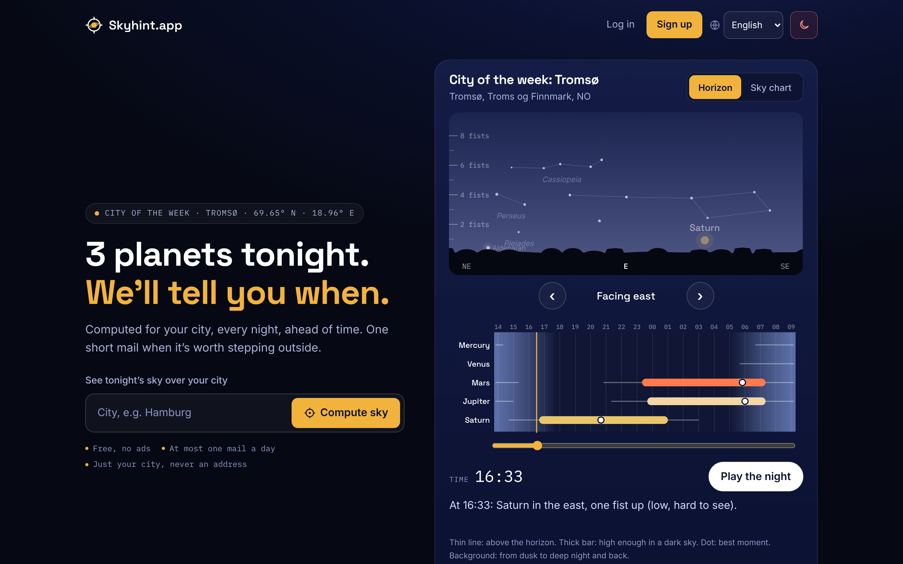
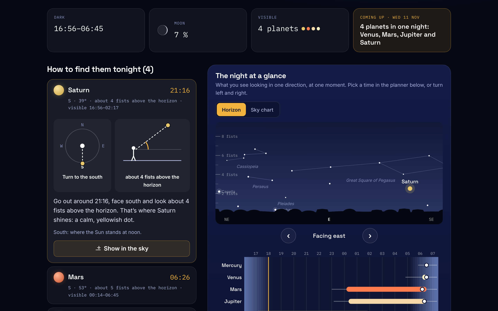
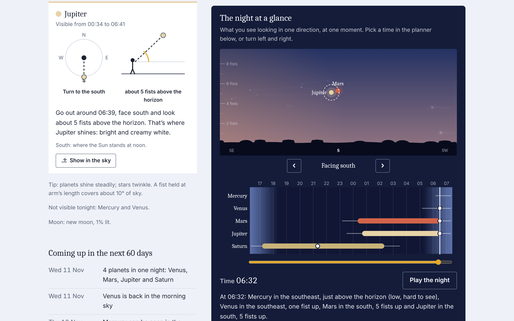
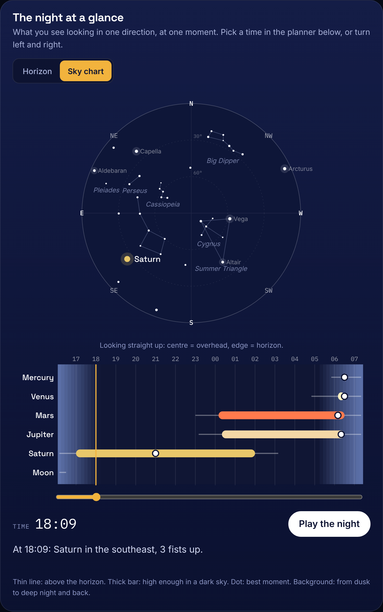
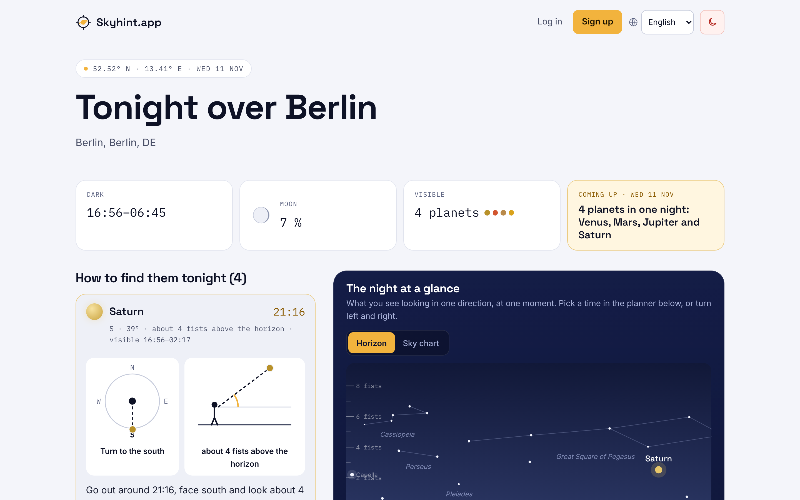
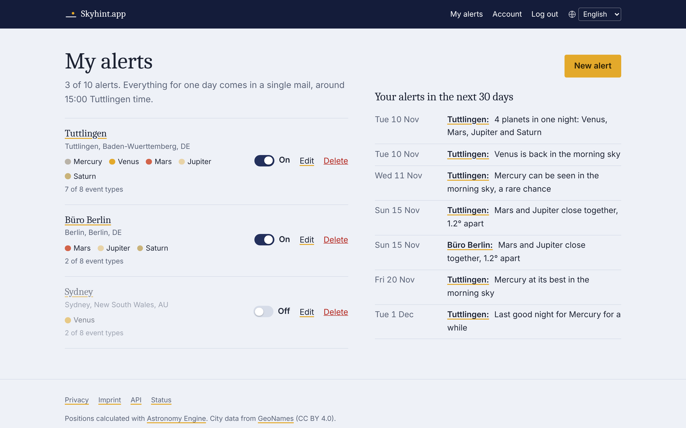
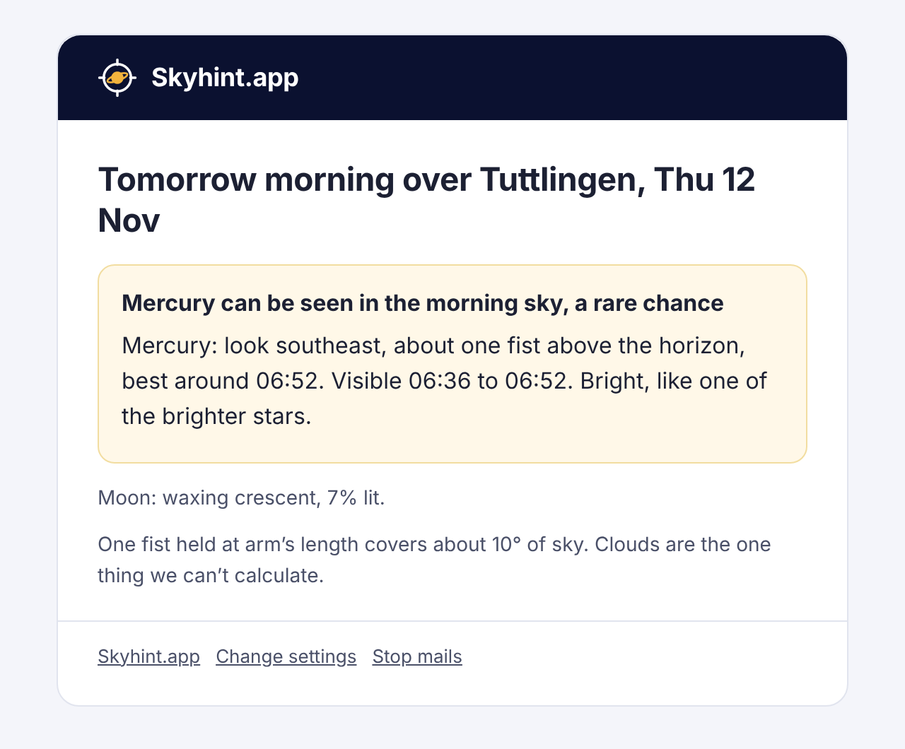
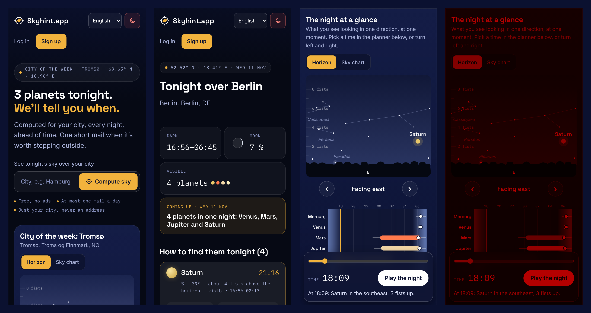
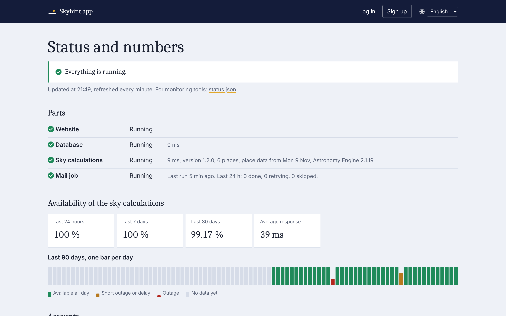

# Skyhint.app

**Know when to look up.** Skyhint.app sends you a short mail ahead of a
night when a planet is worth stepping outside for: Venus back in the
evening sky, Mars at its brightest, Jupiter and Saturn side by side, a rare
window for Mercury. It is calculated for your city, is free, and needs no app.

This repository is the website: pages, accounts, the mail job and the public
API. The sky calculations run on a separate small server, see
**[skyhint-calc](https://github.com/compi2k/skyhint-calc)**.



## Features

- **City pages for anywhere on Earth.** Tonight's sky for any of about 70,000
  cities: which planets you can see, when, in which direction and how high,
  in plain words ("face south and look about four fists up").
- **Sky view, sky chart and night planner.** The horizon view shows what you
  see facing one direction at one moment, with dusk glow, bright stars and
  well-known constellations; the sky chart shows the whole sky looking
  straight up. Drag through the night or press play; turn left and right.
  Opening a planet row jumps to its best moment and puts it in focus.
- **Tonight at a glance.** Darkness, Moon phase, how many planets are up and
  the next special night, in four tiles.
- **Night instrument design.** Dark by default with a light variant for light
  system settings, and a red night-vision mode (one button) that keeps your
  eyes adapted to the dark when you use it outside.
- **Mail alerts.** Up to 10 places per account, each with its own planets and
  event types. Everything for one day goes out in a single mail, in a time
  slot the user picks (morning, midday, afternoon or evening, in any time
  zone). The mail always announces the next night that hasn't started yet at
  each place, so it is never too late, even for places on the other side of
  the world. Optional weekly overview on Sundays. Pause, test mail and
  one-click unsubscribe.
- **Calendar feed and API.** A free API key (confirmed email required) gives
  JSON endpoints and an iCal feed of your alerts.
- **City of the week** on the start page, prepared ahead of time so the start
  page never waits for the calc server.
- **Public status page** with uptime, response times and usage totals,
  privacy-safe: places are only named once at least three accounts watch them.
- **German and English**, each in one file; adding a language means copying
  one file.
- **Privacy:** stores an email address, cities and settings, nothing else. No
  third-party scripts, no ads, no tracking by default. Optional visitor
  statistics with your own Matomo server, without cookies, with an opt-out
  and its own section on the privacy page.

## Screenshots

| City page | A planet in focus |
| --- | --- |
|  |  |

| Sky chart | Light variant |
| --- | --- |
|  |  |

| Your places | The mail |
| --- | --- |
|  |  |





## How it fits together

```
 browser ──HTTPS──▶ skyhint-web (this repo) ──HTTPS + shared secret──▶ skyhint-calc
                    PHP 8.3+, MariaDB                                   Python, Astronomy Engine
                    │                                                   own small server
                    ├── cron every 15 min: mails, city of the week, health check
                    └── SMTP: your own mail server
```

- The **web app** knows the users; the **calc service** knows the sky. The calc
  service only ever receives a city ID and dates, never anything about a user.
- Calc results are deterministic, so the web app caches them in the database
  for days. Pages that need fresh calculations show a friendly error if the
  calc server is down; the start page and status page keep working, and the
  mail job keeps retrying for five hours.
- Plain PHP with no framework and no Composer: PHPMailer is bundled in
  `vendor/`. No build step, no Node. Upload and go.

## Requirements

- PHP 8.3 or 8.4 with `pdo_mysql`, `curl`, `mbstring` and `openssl` (`setup.php`
  checks them)
- MariaDB 10.6+ or MySQL 8+
- An SMTP mailbox to send from, with SPF, DKIM and DMARC set for its domain
- Cron (every 15 minutes, and once a day)
- Apache with `mod_rewrite` (`.htaccess` files are included), or nginx (see below)
- A running [skyhint-calc](https://github.com/compi2k/skyhint-calc) service

Shared hosting with SSH works fine; it was built for a KeyHelp server.

## Install

1. **Calc service first.** Set up [skyhint-calc](https://github.com/compi2k/skyhint-calc)
   and note its URL and secret. Its firewall must allow this server's IP.

2. **Get the code** onto the web server, e.g. in the hosting account's home:

   ```bash
   git clone https://github.com/compi2k/skyhint-web.git
   ```

   Or download the ZIP and upload the folder with SFTP.

3. **Domain.** Point the domain's document root at the **`public`** folder
   (`skyhint-web/public`), with HTTPS. In KeyHelp: Domains → your domain →
   target directory (Zielverzeichnis), PHP 8.4. If you can only point at the
   project folder itself, the `.htaccess` there forwards into `public/` and
   blocks everything else, but `public` is cleaner.

4. **Database.** Create an empty MariaDB database and a user for it. The
   tables are created in step 7.

5. **Mailbox.** Create a sending address such as `noreply@skyhint.app` and make
   sure SPF, DKIM and DMARC are set for the domain.

6. **Config.** Copy `config/config.sample.php` to `config/config.php` and fill
   in every `CHANGE-ME` (see [Configuration](#configuration)). Create the
   secret key with:

   ```bash
   php -r "echo bin2hex(random_bytes(32)), PHP_EOL;"
   ```

7. **Set up and check.** Over SSH, in the project folder, as the user PHP runs
   as (on KeyHelp: `sudo -u <account user> php8.4 …`):

   ```bash
   php bin/setup.php --mail-test=you@example.com
   ```

   It creates or upgrades the tables, checks PHP extensions, folder
   permissions, the text files, the database, the calc service and mail, and
   prepares the city of the week. Fix anything marked `FAIL` and run it again.

8. **Cron jobs** for the same user (KeyHelp: Cronjobs, otherwise `crontab -e`):

   ```
   */15 * * * *  php /path/to/skyhint-web/bin/send-alerts.php
   17 4 * * *    php /path/to/skyhint-web/bin/cleanup.php
   ```

   `send-alerts.php` sends the mails, records the calc server's health for the
   status page and prepares the city of the week. `cleanup.php` removes expired
   tokens, unconfirmed accounts after 7 days, old cache entries and old
   statistics.

9. **Try it.** Open the site, look up your city, sign up, confirm the mail,
   add a place, create an API key. To see what the job would send at a given
   time, without sending anything:

   ```bash
   php bin/send-alerts.php --dry-run --now="2026-11-10 14:05"
   ```

10. **Legal pages.** Fill in the `imprint` section of the config for the legal notice
    (`/impressum`, `/legal-notice`)
    and read `/privacy`. Two statements there depend on how you run the server:
    backups rolling over within 30 days (`privacy.delete_text` in `lang/*.php`)
    and the contact address (`imprint.email`).

### nginx

```nginx
root /path/to/skyhint-web/public;
index index.php;
location / { try_files $uri /index.php$is_args$args; }
location ~ \.php$ {
    include fastcgi_params;
    fastcgi_param SCRIPT_FILENAME $document_root/index.php;
    fastcgi_param HTTP_AUTHORIZATION $http_authorization;
    fastcgi_pass unix:/run/php/php8.4-fpm.sock;
}
```

Only `public/` may be reachable from the web. `config/`, `storage/` and the
rest must not be.

## Configuration

Everything lives in `config/config.php`, which is never part of the
repository. The important keys:

| Key | Meaning |
| --- | --- |
| `app.name` | Shown in the header, mails and page titles |
| `app.url` | Public address without trailing slash; used for links in mails |
| `app.default_lang` | Language for visitors whose browser asks for none we have |
| `app.owner_email`, `app.owner_timezone` | Daily status mail of the mail job (18:00 owner time) |
| `app.secret_key` | Random, 32+ characters; signs sessions, tokens and rate-limit keys |
| `app.home_city` | Fallback GeoNames ID for the start page if no city of the week can be found |
| `app.source_url` | Footer link to the source code (see [License](#license)) |
| `app.debug` | Detailed errors in the browser; never `true` in production |
| `db.*` | Database connection |
| `mail.*` | Sender and SMTP login (`transport` `smtp` or `mail`) |
| `calc.url`, `calc.secret`, `calc.timeout` | The calc service and its `CALC_SECRET` |
| `banner.text`, `banner.style`, `banner.link` | Optional banner across the top of every page, e.g. "Prototype under construction"; text per language or one for all; styles `info`, `warning`, `danger`, `construction` |
| `matomo.url`, `matomo.site_id`, `matomo.retention_days` | Optional visitor statistics, see [Visitor statistics](#visitor-statistics-optional) |
| `imprint.*` | Name, address and contact for the legal notice and `/privacy` |
| `app.show_version`, `app.version_label` | Version number in the footer, optional label such as `beta` |

## Update

```bash
cd skyhint-web && git pull        # or upload the new files over the old ones
php bin/setup.php                 # upgrades the database if needed
```

`setup.php` prints the installed version on its first line; the footer and
the status page show it too. What changed in each version is in
[CHANGELOG.md](CHANGELOG.md). Version numbers: the last digit for fixes, the
middle one for new features, the first one for changes that need manual work
when updating.

`config/config.php` and `storage/` are never overwritten. Older installations
with one alert per account are migrated automatically: each account's city and
settings become its first place, and already-sent events are remembered.

### Moving to a new domain

Everything domain-specific is in `config/config.php`:

1. Add the new domain on the server, pointing at the same `public` folder.
2. Change `app.url`, and `mail.from` / `mail.user` / `mail.password` for the
   new sender address. Set up SPF, DKIM and DMARC for it.
3. Redirect the old domain to the new one, so links in old mails, API clients
   and calendar subscriptions keep working.

No code or database changes needed.

## How the parts work

### The mail job

`bin/send-alerts.php` runs every 15 minutes and, per account:

- once the account's mail time has come, it checks every enabled place and
  sends **one** mail with a section per place;
- on Sundays it does the same for the weekly overview (if chosen);
- if the calc server or the mail server fails, later runs retry for five
  hours, then the day is skipped and shows up in the owner's status mail.

**Mail time.** Each account picks a slot (`morning` 7–9, `midday` 12–14,
`afternoon` 15–17, the default, or `evening` 19–21) in a time zone of its
choice (preset from the signup city). Within the slot, every account gets a
fixed minute derived from its ID, so the mail server never sends everything at
once. Slots and the retry time are constants in `src/MailTime.php`.

**Which night.** For each place, the mail announces the next night whose
darkness hasn't begun there yet: "tonight" before dusk, "tomorrow night"
after. A Berlin user watching Sydney gets Sydney's coming night, not the one
that is half over. Each place remembers the newest night announced
(`alerts.last_night`); if the mail time drifts past dusk (daylight saving,
shorter days), the skipped night is added while it is still running, so no
night falls through the gap. A six-month simulation across both clock
changes, polar night and three continents found no gaps.

Every event is logged per place (`sent_log`), so nothing is ever sent twice,
and every run is recorded per account and day (`mail_runs`).

### Event types

| Type | Default | Meaning |
| --- | --- | --- |
| `comeback` | on | a planet is visible again after at least 14 hidden nights |
| `last_chance` | on | the last good night before a planet disappears for weeks |
| `mercury_window` | on | Mercury is visible (start and best night) |
| `opposition` | on | Mars, Jupiter or Saturn at their brightest, up all night |
| `greatest_elongation` | on | Venus at its highest |
| `planet_pair` | on | two planets less than 2° apart |
| `parade` | on | four or more planets in one night |
| `moon_nearby` | off | the Moon less than 3° from a planet (common) |

### City pages

- **"Go outside" cards** per visible planet: which way to turn (seen from
  above, with a hint for finding the direction), how high to look (seen from
  the side, in fists) and one plain sentence.
- **Night panel**: the sky view and the night planner. Star positions are
  computed in the browser (`public/assets/sky.js`) from a fixed list, so they
  need no data from the calc server. On wide screens the panel stays beside
  the cards while scrolling.

### City of the week

The start page shows the night over a different city every week, from a
curated list in `src/WeekCity.php` (north and south taking turns, the same
city for everyone). The start page never asks the calc server: the mail job
prepares this week's city and tonight's sky in the cache, and the start page
only reads it. If nothing is prepared, it shows no sky but loads normally.

### Status page

`/status` shows health, uptime and usage; `/status.json` the summary for
monitoring tools. Every run of the mail job records whether the calc server
answered (`status_checks`); daily totals live in `stat_counters`. Only totals
are stored, and places are only named once at least 3 accounts watch them.

### Design

One stylesheet, `public/assets/style.css`, with all colours as variables at
the top: dark by default, a light set under `prefers-color-scheme: light`,
and the sky panel always dark. The red night-vision mode
(`public/assets/night.js`) turns the whole page into shades of red; the
choice is kept in the browser's local storage (listed on the privacy page).
The sky view and sky chart are drawn in `public/assets/sky.js` from the
night's track plus a built-in list of bright stars.

### Languages

Every text is in `lang/*.php`, one file per language, named by its two-letter
code. The language menu lists every file there, using its `lang.name`. To add
a language:

```bash
cp lang/en.php lang/fr.php      # translate the values, keep keys and {placeholders}
php bin/check-lang.php          # reports missing strings and placeholders
```

Mails go out in each account's chosen language.

### Visitor statistics (optional)

With your own [Matomo](https://matomo.org) server, set `matomo.url` and
`matomo.site_id` in the config. Then:

- the tracker runs without cookies and without reading screen size or
  plugins (`disableBrowserFeatureDetection`);
- only the path of a page is sent, never its query string, because links in
  mails carry tokens there;
- visitors with Do Not Track or Global Privacy Control, or without
  JavaScript, are not counted;
- the privacy page gets a section on what is collected, with a switch to opt
  out (remembered in the browser's local storage, not a cookie);
- the Content-Security-Policy allows your Matomo server and nothing else.

In Matomo itself, set *Privacy → Anonymize data* to mask 2 bytes of the IP,
and delete old raw data after the same number of days as
`matomo.retention_days`; the privacy page states both. Whether you need
consent for this depends on your country; this setup follows common practice
for consent-free, cookieless analytics in the EU, but it is not legal advice.
Without `matomo.url`, nothing is loaded and the privacy page says there is no
tracking.

## Public API

Free, with a key from the account page (confirmed email required). Full docs
on the site at `/api`.

| Call | Returns |
| --- | --- |
| `GET /api/v1/cities?q=` | Cities by name, largest first |
| `GET /api/v1/sky/tonight?city=` | Darkness, Moon, and when and where each planet is visible |
| `GET /api/v1/events?city=&from=&to=&types=` | Events between two dates (default: next 90 nights) |
| `GET /api/v1/events.ics?key=` | Calendar feed of your enabled places (key in the URL for calendar apps) |
| `GET`, `PATCH /api/v1/me` | Your account: mail style, language, mails on/off, `mail_slot`, `mail_tz` |
| `GET`, `POST /api/v1/alerts` | Your places (up to 10) |
| `GET`, `PATCH`, `DELETE /api/v1/alerts/{id}` | One place |

```bash
curl -H "Authorization: Bearer <key>" "https://skyhint.app/api/v1/sky/tonight?city=2950159"
```

Limits: 60 requests per minute and 5,000 per day per key. Errors use HTTP
status codes with a JSON body; 429 and 503 come with `Retry-After`.

## Security and privacy

- Argon2id password hashes; verification and reset tokens and API keys are
  stored only as SHA-256 hashes.
- CSRF tokens on every form, secure session cookies, strict
  Content-Security-Policy (no inline scripts or styles).
- Rate limits on login, signup, reset, search and the API, keyed by hashes
  (no raw IPs or emails stored).
- Signup and password reset give the same answer whether or not an address is
  registered.
- One-click unsubscribe (RFC 8058) in every alert mail.
- `/privacy` lists exactly what is stored. Unconfirmed accounts are deleted
  after 7 days, the sent-mail log after 400 days.

Found a security problem? Please report it privately through GitHub's
security advisories for this repository rather than in a public issue.

## Development

```bash
cp config/config.sample.php config/config.php     # local database, mail and calc settings
php bin/setup.php
php -S localhost:8080 -t public bin/dev-router.php
```

Developer notes, the full local test setup and the end-to-end test
(`tests/e2e.py`) are described in [CLAUDE.md](CLAUDE.md).

For the calc service, run [skyhint-calc](https://github.com/compi2k/skyhint-calc)
locally with its six-city test list (see its README) and set `calc.url` to
`http://127.0.0.1:8100`. To catch mails locally, point `mail.*` at a capture
tool such as Mailpit (`localhost:1025`, `secure` empty).

| Part | Where |
| --- | --- |
| Routes | `public/index.php` |
| Pages, signup, places, account, API, status | `src/Controllers/` |
| Places per account | `src/Alerts.php` |
| Mail job | `src/AlertJob.php`, `bin/send-alerts.php` |
| City of the week | `src/WeekCity.php` |
| Calc client with database cache | `src/Calc.php` |
| Sentences in mails and pages | `src/Format.php`, `lang/*.php` |
| Event types and defaults | `src/Prefs.php` |
| Database schema | `sql/schema.sql` |
| Templates, styles, scripts | `templates/`, `public/assets/` |

Logs: `storage/logs/app.log` (job runs, mail failures) and
`storage/logs/php-error.log`.

## License

[GNU Affero General Public License v3.0 or later](LICENSE).

You may run, change and share it. If you run a modified copy as a public
service, you have to offer its source code to its users. The footer link to
`app.source_url` is there for that: point it at your fork.

## Credits

- Positions: [Astronomy Engine](https://github.com/cosinekitty/astronomy) by
  Don Cross (MIT), used by the calc service.
- City data: [GeoNames](https://www.geonames.org) (CC BY 4.0), credited in the
  site footer.
- Mail: [PHPMailer](https://github.com/PHPMailer/PHPMailer) 6.10 (LGPL-2.1),
  bundled in `vendor/phpmailer`.
- Fonts: Inter, Space Grotesk and IBM Plex Mono (SIL Open Font License 1.1),
  self-hosted in `public/assets/fonts` so no visitor data goes to a font
  service.
